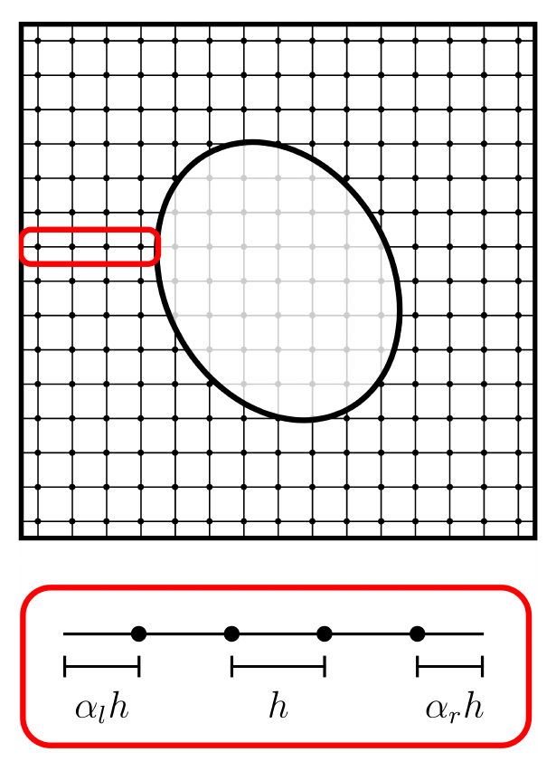

## Overview

My Ph.D. was done at the University of Waterloo with residency at the Perimeter Institute for Theoretical Physics, advised by Niayesh Afshordi and Erik Schnetter. The thesis brings together and extends my work on boundaries in numerical relativity:

- **Chapter 2, Numerical relativity in spherical symmetry:** reflecting boundary conditions for a scalar field in a fully dynamical spacetime, using the Einstein-Christoffel formulation. This builds on my paper [Reflecting boundary conditions in numerical relativity as a model for black hole echoes](/research/2023-01-13-ReflectioningBCs/).
- **Chapter 3, Spacetimes with no symmetries:** the generalized harmonic formulation cast into a summation by parts scheme, an embedded boundary method for arbitrarily shaped domains, and gravitational wave scattering off a boundary near a black hole horizon. This builds on my paper [Formulating the complete initial boundary value problem in numerical relativity to model black hole echoes](/research/2024-12-17-IBVP/).
- **Chapter 4, Boundary conditions based on quasi-local conservation laws:** a framework for boundary conditions that control the quasi-local energy flux through a boundary, motivated by analogous examples in electromagnetism.

*The embedded boundary method on a 2D slice. The grid points inside the ellipse exist in memory but are not evolved. Finite differencing stencils along each grid line depend on the grid spacing $$h$$ and on the distances $$\alpha_l h$$ and $$\alpha_r h$$ from the boundary to the ends of the line (zoomed in red).*
{: style="text-align:center; font-size:90%"}

The simulation code is available at [GR3D.jl on GitHub](https://github.com/TakeTwiceDailey/GR3D.jl).

## Conclusion

This thesis demonstrates and formulates the initial boundary value problem in numerical relativity, so that Einstein's field equations can be evolved with boundaries placed in the strong gravity region of a dynamical spacetime. The motivations are to simulate black hole echoes by imposing reflecting boundary conditions near a horizon, to make binary black hole merger simulations cheaper by coupling with Cauchy characteristic matching and shrinking the Cauchy domain, and to simulate arbitrary compact objects given only the evolution of a surface around them and the boundary conditions on it.

Part of this success comes from analytical tools that guide the form of the evolution equations, such as symmetric hyperbolicity, which allows for an energy estimate. The other part comes from modern numerical methods: summation by parts operators and simultaneous approximation terms keep the energy estimate approximately conserved on a discrete grid, and embedded boundary methods allow arbitrarily shaped domains on a rectangular grid. Finally, boundary conditions on the radiative degrees of freedom of the metric can be set by controlling the quasi-local energy flux through the boundary. Like electromagnetic waves, gravitational waves need two conditions: one for conservation of energy and one to specify polarization.

These methods open the door to non-spherical and non-convex inner boundaries, dynamical inner boundaries, non-cubical outer boundaries, and higher accuracy operators (see my follow-up work on [upwind embedded boundary SBP operators](/research/2026-07-15-embedded-upwind-SBP/)). Evolving a dynamical boundary tied to dynamical black holes would allow merger simulations with reflecting boundaries near the horizons, which would be the first nonlinear simulation of black hole echoes.
