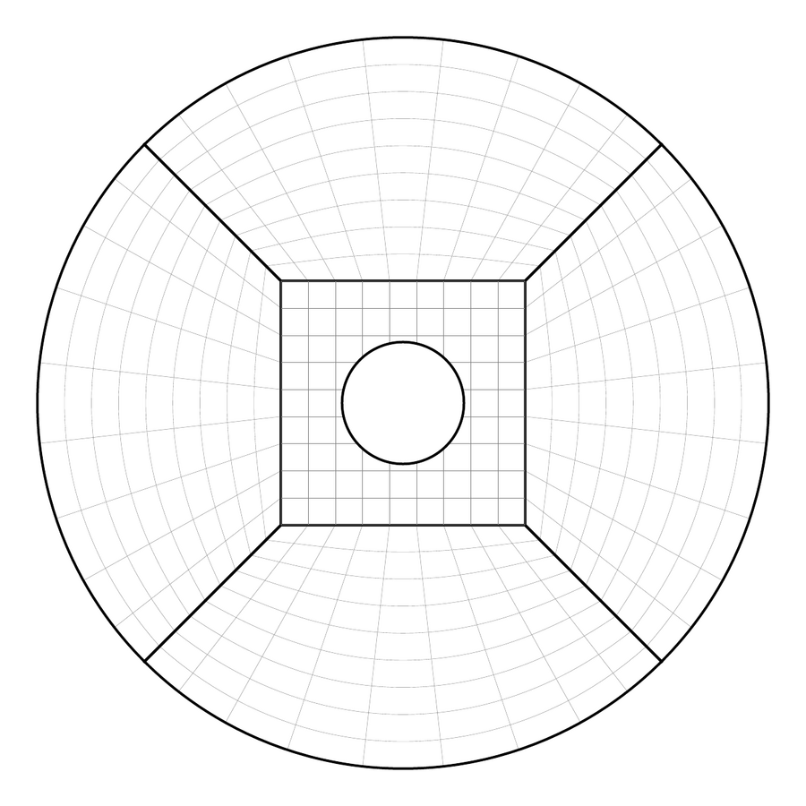
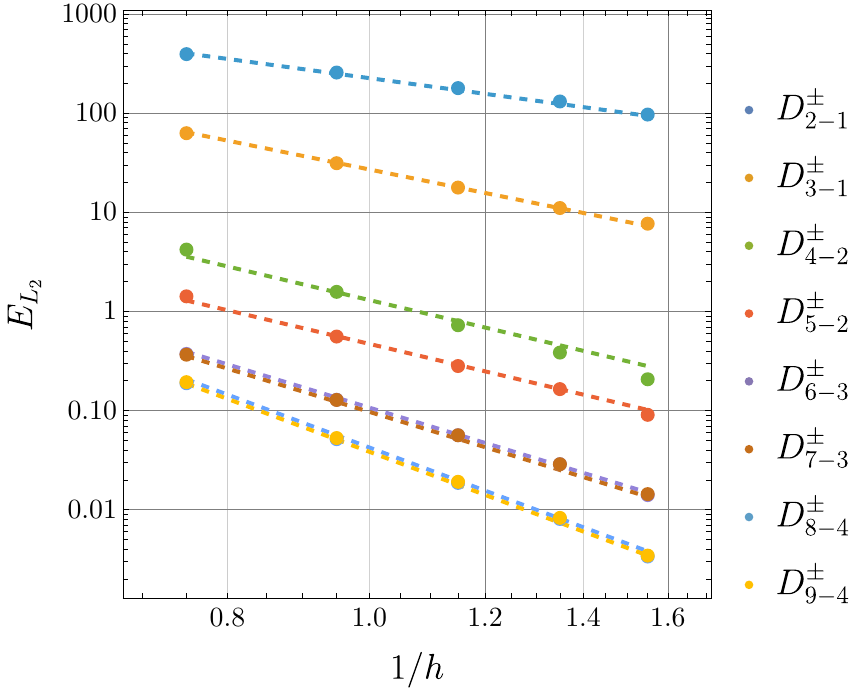

## Introduction

Finite difference (FD) methods are a popular way to numerically solve hyperbolic partial differential equations. They are attractive for initial boundary value problems (IBVPs) because their derivative stencils are local. Modern CPU and GPU codes are usually limited by memory bandwidth rather than compute, so this locality matters: narrow stencils keep costs down, and FD domains scale naturally to thousands of devices.

Traditionally, FD methods are difficult to apply to IBVPs because the stencils must change consistently near a boundary so that only grid points inside the domain are used. This is part of the motivation for the summation by parts (SBP) framework, where FD operators are defined near the boundaries in a way that guarantees stability of linear hyperbolic problems through the energy method. However, the vast majority of SBP methods require the last grid cell to coincide with the boundary. In 2D and 3D this means the grid itself must be shaped to fit the boundary, for example with multiblock grids. That approach clusters grid cells near an inner boundary, which restricts the stable time step, and it cannot easily handle a *dynamic* excision boundary.

Black hole excision in numerical relativity is a prime example of where this matters: the singularity inside a black hole must be cut out of the numerical domain so it does not spoil the solution outside. Another is worldtube excision, where a perturbed analytic solution inside the excision boundary is coupled to the numerical domain. The embedded boundary SBP method solves this by allowing boundaries that do not conform to the grid. A regular Cartesian grid can be used, an arbitrarily shaped boundary can be placed on it, and the FD stencils adapt naturally to the boundary's position. I previously [demonstrated this method for the nonlinear Einstein equations in 3D](/research/2024-12-17-IBVP/).

*Equatorial slice of the test domain: seven grid blocks in a cubed-sphere layout, with a sphere excised from the central Cartesian block using the embedded boundary method.*
{: style="text-align:center; font-size:90%"}

The previously known embedded boundary operators were limited to interior accuracy orders $$p=2, 4, 6$$ (here called the $$D_{2-1}$$, $$D_{4-2}$$, and $$D_{6-3}$$ operators, since a diagonal norm halves the accuracy at the boundary). This work derives several new diagonal norm *upwind* SBP operators generalized to embedded boundaries, with interior orders from $$p=2$$ through $$p=9$$. Upwind schemes approximate the dispersion relation of wave equations much more accurately than traditional centered schemes while remaining explicit, and they tend to converge better than expected. A second family of dispersion relation preserving operators trades some accuracy for minimal dispersion error, so that waves keep the right time of flight over long distances.

## Results

The operators are tested with the curvilinear scalar wave equation on the 3D multiblock grid above, with the excision sphere embedded in the central block.

*Convergence of the new $$D^\pm_{p-b}$$ operators, measured by the total $$L_2$$ error over the domain. Dashed lines show the expected convergence rate of $$b+1.5$$ for boundary order $$b$$; some operators outperform it.*
{: style="text-align:center; font-size:90%"}

## Conclusion

These are the highest order embedded boundary finite differencing methods derived to date: up to $$9^{\rm th}$$ order accurate in the interior, with boundary closures up to $$4^{\rm th}$$ order. The highest convergence rate achieved in the 3D tests is about $$5.5$$ in the $$L_2$$ norm.

The operators can evolve first order hyperbolic problems with arbitrarily shaped boundaries while keeping the simplicity of a Cartesian grid and the efficiency of finite differencing. They reduce to traditional boundary conforming operators when the boundary position parameter is zero, and can even join grids that overlap by less than one grid spacing. In particular, they make black hole excision with finite differencing straightforward to implement, without boundary conforming grids and without losing high accuracy.

Next steps include coupling these operators with dynamical boundary methods for moving excision boundaries in black hole mergers, worldtube excision on a stationary Cartesian grid, and testing the dispersion relation preserving operators for long-distance gravitational wave propagation. The paper's supplementary material includes the operator coefficients and a Mathematica notebook to re-derive them.
